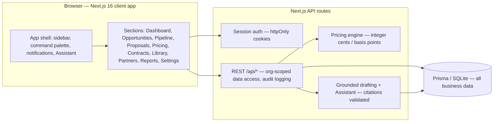

# BidDesk

<p align="left"></p>

**Capture, proposals and contracts for government contractors.**

BidDesk is one system of record for the whole contract lifecycle: find opportunities, decide
whether to bid, respond to the solicitation, price it, manage the contract after award, and feed
past performance back into the next bid. Nothing is retyped between phases.

- **Opportunities** — SAM.gov notices with transparent match scoring (every factor shown),
  saved searches, dismissal with reason, manual entry and CSV import for state and local work.
- **Pipeline** — qualification through the bid/no-bid gate: kanban stages, PWin factor scoring
  with live weighted value, gate review scorecards with approval, teaming agreements.
- **Proposals** — solicitation intake across Section L / M / PWS / CDRLs / clauses, a compliance
  matrix with page-and-paragraph citations humans verify, an annotated outline, a split writing
  workspace with grounded drafting (citations required, needs-input instead of invention),
  color-team reviews with findings dispositions, and a submission readiness checklist.
- **Pricing** — loaded rate build-ups (fringe, overhead, G&A, fee) in decimal-safe integer math,
  multi-period escalation, CLIN totals, sensitivity scenarios, CALC+ benchmark comparison.
- **Contracts** — CLINs and funding, deliverable schedules, modifications, option exercise
  windows, CPARS tracking, subcontractors, invoice log, closeout checklist, and one-click
  past-performance records for the Library.
- **Library** — company profile, past performance, resumes, and approved content; only approved
  items are eligible for grounded drafting.
- **Partners, Reports, Settings** — teaming directory; live analytics (pipeline, win rate,
  timeliness, backlog); users, role permission matrix, integrations, Assistant generation log,
  and the append-only audit trail.

## Architecture



## Requirements

Runs anywhere Node.js or Bun runs; the managed preview runs it with Bun. No external services
are required for the core product — the database is embedded (SQLite through Prisma).

## Quick start

```bash
bun install
bun run db:push        # create/update the database schema
bun prisma/seed.ts     # create the demonstration workspace (sample data)
bun run dev            # http://localhost:3000
```

Sign in with a demonstration account (shared sample password `BidDesk2025!`):

| Role | Email |
|---|---|
| Owner | dana.whitfield@harborpointtech.com |
| Capture Manager | marcus.lee@harborpointtech.com |
| Proposal Manager | priya.nair@harborpointtech.com |
| Contracts Manager | elena.ruiz@harborpointtech.com |
| Pricing Analyst | sam.ortiz@harborpointtech.com |

The persistent banner confirms the demonstration state; **Reset** restores the initial sample
data; **Start walkthrough** runs the guided lifecycle tour.

## Configuration

All configuration is environment variables (see `.env`). `DATABASE_URL` is the Prisma
datasource URL. Integration credentials (SAM.gov API key, SMTP, AI provider) are entered in
Settings → Integrations and documented in `docs/ARCHITECTURE.md`.
No secrets are committed.

## Data sources

- **SAM.gov Get Opportunities Public API v2** — federal notices. Requires a free API key
  (Settings → Integrations). The adapter ships disabled until a key is provided; manual entry,
  CSV import, and email-forward intake support any jurisdiction without a key. Adapters that
  cannot be verified are marked disabled with a reason — never mocked.
- **USAspending API v2** — award history for incumbent and market analysis (no key required).
- **GSA CALC+** — labor-rate benchmark snapshots.

Endpoint URLs and field maps live in configuration, not scattered in code.

## AI configuration

The Assistant and grounded drafting use the configured provider (`z-ai-web-dev-sdk` on the
server, never in the browser). Drafting draws only on the section's linked requirements and
**approved** Library items; every generated sentence carries a validated citation, insufficient
support returns a structured needs-input response, drafts require human acceptance, and every
generation is logged with its sources. If AI is not configured, the product works fully for
everything except generation and extraction assistance, and the UI says so.

## Security and compliance

BidDesk implements strong technical controls: session authentication, per-organization data
isolation on every query, an append-only audit log, role-based permission matrix, and
per-document AI-processing intent. Contractors handling CUI must follow NIST SP 800-171, and
cloud services storing or processing CUI for DoD work must meet FedRAMP Moderate or equivalent.
BidDesk provides the technical controls; certification and hosting-environment compliance are
the deploying organization's responsibility. BidDesk does not claim FedRAMP or CMMC
certification.

## Project structure

```
prisma/schema.prisma     Domain model (org-scoped; money = integer cents)
prisma/seed.ts           Demonstration workspace (sample data, labeled)
src/app/page.tsx         The application (single user route)
src/app/api/*            REST API (auth, opportunities, pursuits, proposals, pricing,
                         contracts, library, partners, reports, settings, audit, search,
                         notifications, tasks, assistant, demo reset)
src/components/biddesk/  App shell, sections, shared primitives, Assistant, walkthrough
src/lib/                 db client, auth, money math, pricing engine, formatters, store
brand/                   logo-full.svg (favicon ships in public/)
docs/                    ARCHITECTURE.md (decision record + frontend contract)
```

## Verification

```bash
bun run lint            # ESLint — code quality and Next.js rules
```

Every module was exercised end to end in a browser as part of the build: sign-in, opportunity
tracking, PWin scoring, gate decisions, compliance matrix verification, grounded draft
acceptance, review dispositions, pricing recalculation and CLIN carry, contract modifications,
option exercise, CPARS response, library approval, and the audit trail.

## License

Proprietary. All rights reserved.
